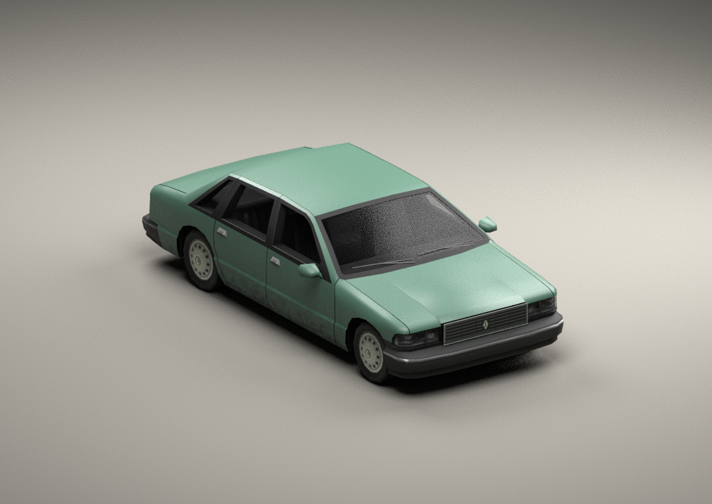

# GTA SA vehicle prototypes

The newest vehicle is **[the Pip 660](pip660/README.md)**, a tiny two-seat city
car with a newly authored body, interior, wheels, damage parts and collision.

The **[Geniusmobile](geniusmobile/README.md)** is the Picador street/show-truck
conversion. Both include game assets, editable source and integration notes.
The earlier Linden proof of concept is documented below.

# Linden 1800 — GTA San Andreas vehicle MVP

A fictional late-1980s sedan for **classic PC GTA SA 1.0 / downgraded SA**.
Replaces the **Premier, model ID 426**. The goal is the ordinary stock-car
aesthetic: simple surfaces, small textures, restrained detailing and a stock
geometry budget.



**This is a Premier-derived prototype.** It has an edited body and original new
trim/texture work; it is not a car modeled entirely from scratch. The supplied
Premier provides the body topology, interior, wheels, rig, damage meshes and
collision. This keeps the first proof of concept focused and usable as a
replacement without adding vehicle IDs or requiring a limit adjuster.

## Install

Download or extract **[dist/linden-mvp.zip](dist/linden-mvp.zip)**.

1. With Mod Loader already installed, copy the ZIP's `modloader/linden/` folder
   into your GTA SA game folder. The result should be
   `GTA San Andreas/modloader/linden/premier.dff` and `premier.txd`.
2. Remove or disable other mods replacing the Premier to avoid conflicts.
3. Start the game and find or spawn a **Premier (426)**. Its displayed name is
   still Premier, and it uses the stock Premier handling, colours and sound.

Uninstall by removing `modloader/linden/`. No stock game archive, configuration
file, `vehicle.txd`, or savegame needs to be edited. Without Mod Loader, an IMG
editor can replace the two Premier entries in a backup of `models/gta3.img`.

## What changed

- Narrower, slightly lower cabin with a rearward roof shift and shorter
  overhangs. The shape change is applied consistently to intact parts, damaged
  variants and the low-detail body, with matching attachment-frame positions.
- A new slatted grille, small diamond emblem, bright grille edges, and central
  dividers for the rectangular headlights.
- Charcoal plastic bumpers, a rear `LINDEN 1800` garnish, and twelve-slot wheel
  covers with newly authored radial UVs.
- One **128×128 diffuse atlas**, with eight explicit mip levels down to 1×1.
  Body dirt, glass, tyres, interior and lamp textures reuse stock SA assets.
- Existing primary/secondary paint channels and all four engine lamp-control
  material tags remain in place. The bumpers are deliberately unpainted.

## Files

| Path | Contents |
|---|---|
| `dist/linden-mvp.zip` | Installable Mod Loader package and installation notes |
| `dist/modloader/linden/premier.dff` | The actual RenderWare 3.6.0.3 game model |
| `dist/modloader/linden/premier.txd` | Original Premier rasters plus the new atlas |
| `assets/linden.blend` | Editable DragonFF import with native hierarchy, damage variants, collision and packed textures |
| `assets/textures/linden128.png` | Authored diffuse atlas, at its native resolution |
| `assets/build_report.json` | Per-part triangle counts and donor/output hashes |
| `assets/validation_report.json` | Checks performed on the delivered files |
| `previews/` | Front, rear, side and donor comparison renders |
| `tools/` | Reproducible model/texture builder, texture decoder, validators and Blender scripts |

The render script opens the **delivered DFF**. It does not use a separate,
higher-detail presentation model. Blender lighting approximates materials; these
images are **offline renders, not screenshots from GTA**. Preview wheel copies
represent the three extra wheels the game instantiates from the RF wheel mesh.

## Asset budget and checks

| Metric | Stock Premier | Linden |
|---|---:|---:|
| Triangles across all 22 geometries, including LOD and damage variants | 2,927 | 2,868 |
| Intact visible triangles with all four wheel instances | 2,652 | 2,593 |
| New texture | — | 128×128, 8 mips |

The supplied stock sedans contain 2,553–3,152 triangles across their stored
geometries. The Linden stays within that range. Neither count is a count of
quads; the all-parts count includes meshes the game does not show together.

Validation passed **203 asset checks**, including geometry/material indices,
UV/normal lengths, bounding spheres, bin-mesh lists, texture dependency
resolution, mip sizes, frame hierarchy, atomic bindings and lamp tags. DragonFF
independently parsed the DFF and TXD; its decoded custom texture pixels match
the source exactly at every mip. Its DXT1 decoding differs from Pillow's by at
most 1/255 on the unchanged donor rasters.

**In-game testing has not been performed:** this environment has no GTA SA
runtime. Original collision is retained byte for byte as a conservative stock
envelope; it is not a newly fitted collision mesh. Wheelbase and track are
unchanged. Tuning-part fit, door/bonnet opening, damage transitions, night lamps,
reflections and distant LOD appearance need checking in the game. The LOD uses
the reshaped stock simplified body rather than a newly detailed grille.

Suggested first game check: inspect all sides in daylight, turn on the lights,
enter/exit both front doors, open/damage the bonnet and boot, damage each bumper,
drive over a kerb, and move far enough away to trigger LOD. Those checks are
pending, not implied by the file-format checks above.

## Rebuild

Python 3.12+, Pillow 12.3.0 and Blender 4.3.2 were used. From this checkout:

```sh
python -m pip install -r requirements.txt
python tools/build_linden.py
python tools/txd_textures.py
python tools/validate_assets.py
python tools/package_release.py
blender -b --threads 4 --python tools/preview.py -- dist/modloader/linden/premier.dff previews/linden
```

The Python tools resolve paths from their own location and also work when
invoked outside the checkout. Reference files are extracted from the supplied
`vehicle_reference.zip` into the ignored `reference/` directory. The original
ZIP is left unchanged.

For independent format checks and the native editable Blender file, obtain
[DragonFF](https://github.com/Parik27/DragonFF), then:

```sh
git clone https://github.com/Parik27/DragonFF.git /tmp/savehicles-dragonff
git -C /tmp/savehicles-dragonff checkout 54baca8ea2ed95fe5a86917f44399ce677379c59
python tools/validate_assets.py --dragonff /tmp/savehicles-dragonff
blender -b --python tools/blender_source.py -- /tmp/savehicles-dragonff
```

The `.blend` retains all damage/LOD/collision objects, hidden as appropriate.
One duplicate face in the donor chassis is skipped by DragonFF's Blender
importer. The deliverable DFF is built directly by the Python builder, so its
geometry is not changed by that import. Install DragonFF in Blender to work with
its GTA-specific properties and export UI; this project does not bundle it.

The minimal RenderWare helper in `tools/rw_dff.py` comes from the user's supplied
`savibe_example/dff.py`. Stock assets come from the user's reference ZIP.
DragonFF is an external GPL-licensed tool, used for import and validation.
