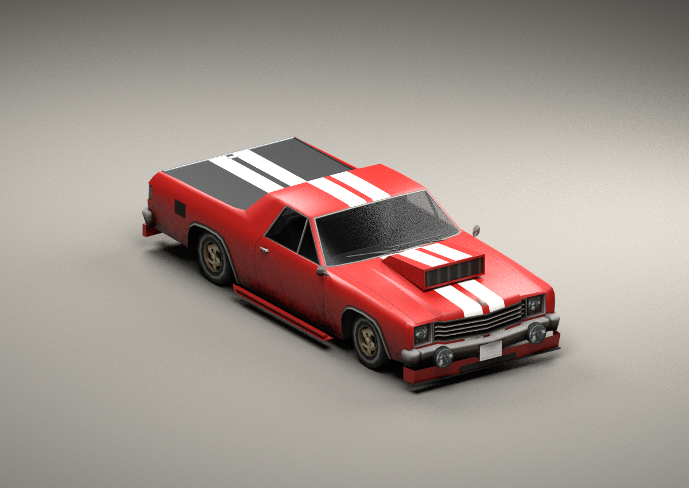

# The Geniusmobile

A Picador street/show-truck build for SAVibe, following the supplied
[model brief](BRIEF.md). It keeps the Picador's shape and gives Ryder's pickup
a fitted scoop, lower body kit, a striped hard bed cover and twin exhausts.



**[Download the game assets](dist/geniusmobile.zip)** and read
**[the integration note](INTEGRATION.md)** before replacing the existing model.
The new TXD name and mission upgrade changes matter.

## Revision 2

Exhaust follow-up: both pipes now extend 35 cm farther inward to enter the
rear apron. The tips, bed cover, collision and textures are unchanged.

Fixes the load crash found in the first Geniusmobile: removing optional cargo
atomics left `extra1`/`extra2` frames behind. SA assumes each `extraN` frame has
an atomic. Those two unused frames now have ordinary names, preserving the
original frame indices and transforms; the validator exercises this failure.

The lower kit now enters the original rocker/bumper surfaces instead of
floating outside them. The closed sill profiles taper into the wheel openings,
and both aprons wrap the bumper corners and slope inward below them. The scoop
has a lower arched mouth, rounded shoulders and a rear ramp fitted to the
bonnet. Its opening is opaque-backed, and its damaged variant follows the
original bonnet dent. The TXD and mission integration are unchanged.

Independent surface probes verify the exported trim intersects the donor at
both sides and the centre, the doors clear the sills, and the scoop mouth is
backed. A deliberately detached sill fails the attachment probe. These are
Blender previews and offline checks; this revision still needs an in-game test.

## Contents

- `dist/geniusmb.dff`, `dist/geniusmb.txd`: game assets for your IMG/IDE pipeline.
- `dist/geniusmobile.zip`: those files, integration notes, hashes and reports.
- `assets/geniusmb.blend`: editable native DragonFF import, with packed textures,
  all damage parts and embedded collision data.
- `assets/genius_detail128.png`: the new authored diffuse atlas, 128×128 with
  eight mip levels in the TXD. No PBR maps or graphics mod are needed.
- `assets/build_report.json`, `assets/validation_report.json`: actual output
  budgets, collision changes, file hashes and the checks performed.
- `previews/base_front.png`: the delivered model with its default stock wheels.
- `previews/mission_*.png`: the same body with the retained stock Dollar wheel
  and round-spotlight upgrades assembled at their game attachment points.
- `previews/damage_front.png`: damaged variants, including the scoop following
  the original bonnet dent displacement.

These are Blender renders, not GTA screenshots. The preview assembly adds
mission upgrades for context; no separate high-detail body is used.

## Budgets and validation

| Metric | Stock Picador | Geniusmobile |
|---|---:|---:|
| Stored triangles, including damage/LOD and donor optional extras | 3,207 | 5,072 (extras removed) |
| Intact visible triangles with four stock wheels, excluding optional cargo | 2,786 | 3,760 |
| Original damage spheres retained | 32 | 32 |
| Collision boxes | 0 | 6 |
| Collision mesh triangles | 12 | 72 |
| Shadow triangles | 236 | 296 |

The retained Dollar upgrade adds 472 visible triangles across all four wheels
relative to the default wheel. The round spotlights add 96. Geometry remains
deliberately simple; the new texture adds about 85 KiB of uncompressed native
mip payloads. The original two TXD rasters are copied without recompression.

The exported material batches put opaque geometry before transparent geometry.
This is checked independently against the material alpha values, and the
validator is exercised against the previous Linden failure. Original Picador
lamp faces, normals, UVs, controller colours, alpha values and glow frames are
retained. New painted bumper trim enables material-colour modulation explicitly.

Closed colour-3 stripe surfaces replace the corresponding cover surface pieces;
there are no overlapping cover-stripe decals. The existing body stripes use
the user's original geometry-cutting helper. Collision retains the donor's
component/damage spheres and extends it for the cover, scoop and lower trim;
the base shell has not been stretched or resized.

All 509 asset checks passed, and a repeat build reproduces the DFF/TXD/atlas
byte for byte. This establishes offline file consistency. It does not replace
the pending game checks listed in the integration note.

## Rebuild

From the repository root, using Python 3.12+, Pillow 12.3.0, Blender 4.3.2 and
[DragonFF](https://github.com/Parik27/DragonFF) at commit
`54baca8ea2ed95fe5a86917f44399ce677379c59`:

```sh
python -m pip install -r requirements.txt
git clone https://github.com/Parik27/DragonFF.git /tmp/savehicles-dragonff
git -C /tmp/savehicles-dragonff checkout 54baca8ea2ed95fe5a86917f44399ce677379c59
python geniusmobile/tools/build.py --dragonff /tmp/savehicles-dragonff
python geniusmobile/tools/validate.py --dragonff /tmp/savehicles-dragonff
python geniusmobile/tools/prepare_preview.py
blender -b --python-exit-code 1 --threads 4 --python geniusmobile/tools/render.py -- geniusmobile/assets/mission_preview.dff geniusmobile/previews/mission
blender -b --python-exit-code 1 --threads 4 --python geniusmobile/tools/render.py -- geniusmobile/dist/geniusmb.dff geniusmobile/previews/base --front-only
blender -b --python-exit-code 1 --threads 4 --python geniusmobile/tools/render.py -- geniusmobile/dist/geniusmb.dff geniusmobile/previews/damage --damage --front-only
blender -b --python-exit-code 1 --python geniusmobile/tools/blender_source.py -- /tmp/savehicles-dragonff
python geniusmobile/tools/package.py
```

`prepare_preview.py` decodes temporary preview textures and assembles stock
upgrades separately from the actual deliverable. Generated decoded PNGs and
studio `.blend` files are ignored; the native editable source is retained.
The Python builder also works when invoked by absolute path from outside the
checkout. If DragonFF is already present at the pinned commit, reuse it.

## Provenance

`donor/` contains the Picador, shared vehicle textures, and the two retained
visible upgrades from the user's full reference pack. `tools/stripes.py` is the
user-supplied `savibe_example/stripes.py`; it uses the minimal RenderWare helper
from the earlier supplied pack in the repository's `tools/rw_dff.py`. New model
details and the new atlas are authored by the procedural builder. DragonFF is
an external GPL tool used for COL serialization, independent parsing and native
Blender import; its code is not bundled. The research notes are in
[`docs/vehicle-research.md`](../docs/vehicle-research.md).
