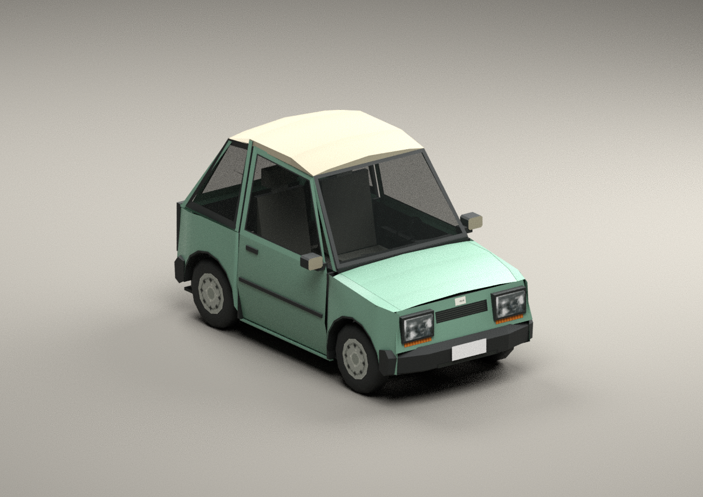

# Pip

A fictional early-1990s two-seat city car for classic PC GTA SA. Tall glass,
a short nose, small pressed-steel wheels, simple plastic bumpers and a cream
roof over sage-green paint give it a distinct shape among the stock compacts.



**[Download the game assets](dist/pip660.zip)** ·
**[Read the integration note](INTEGRATION.md)** ·
**[Rear view](previews/pip_rear.png)** · **[Side view](previews/pip_side.png)**

This is a new body, interior, wheel set, damage geometry and LOD. The stock
Manana is used as the two-door rig/material reference; none of its geometry
is used in the exported car. The earlier Geniusmobile is unchanged.

## Included

- `dist/pip660.dff`, `dist/pip660.txd`: independently named game assets.
- `dist/pip660.zip`: flat game package, install notes, data snippets and hashes.
- `assets/pip660.blend`: editable native DragonFF import with packed textures,
  moving/damage parts and collision.
- `assets/pip_detail128.png`: authored diffuse atlas, 128×128, eight TXD mips.
- `data/`: IDE template and an initial handling tune for your own integration.
- `assets/build_report.json`, `assets/validation_report.json`: exact file hashes,
  part budgets and checks.
- `previews/`: actual exported geometry rendered intact, damaged and with its
  doors, bonnet and hatch posed open. These are offline Blender renders.

## Dimensions and budget

| Metric | Pip |
|---|---:|
| Overall length | 3.11 m |
| Body width / width including mirrors | 1.46 / 1.73 m |
| Height | 1.715 m |
| Wheelbase / tyre diameter | 1.92 / 0.58 m |
| Intact triangles, including four wheel instances | 1,941 |
| Stored triangles, including damage and LOD | 2,247 |
| Custom textures | One 128×128 diffuse atlas |
| Collision / shadow mesh triangles | 36 / 36 |

The meshes use stock paint markers, normal/prelight/UV attributes, a separate
low-detail model and opaque material batches before every transparent batch.
The headlights are opaque backed lenses with the original engine controller
tags and shared switchable light map. The cabin includes two adult-size seats,
dash/instruments, steering wheel, door trim and luggage space. The bonnet has
an engine bay below it; the hatch opens to the luggage floor.

444 exported-asset checks pass. This proves offline consistency, not runtime
behaviour. In-game load, occupants, lights, handling, damage and moving panels
still need the checks listed in the integration note.

## Rebuild

Use Python 3.12+, Pillow 12.3.0, Blender 4.3.2 and external
[DragonFF](https://github.com/Parik27/DragonFF) at commit
`54baca8ea2ed95fe5a86917f44399ce677379c59`. Reuse the existing pinned checkout
when present; work in the existing repository checkout.

```sh
python -m pip install -r requirements.txt
python pip660/tools/build.py --dragonff /tmp/savehicles-dragonff
python pip660/tools/validate.py --dragonff /tmp/savehicles-dragonff
python pip660/tools/prepare_preview.py
blender -b --python-exit-code 1 --threads 4 --python pip660/tools/render.py -- pip660/dist/pip660.dff pip660/previews/pip
blender -b --python-exit-code 1 --threads 4 --python pip660/tools/render.py -- pip660/dist/pip660.dff pip660/previews/damage --damage --front-only
blender -b --python-exit-code 1 --threads 4 --python pip660/tools/render.py -- pip660/dist/pip660.dff pip660/previews/open --open --front-only
blender -b --python-exit-code 1 --python pip660/tools/blender_source.py -- /tmp/savehicles-dragonff
python pip660/tools/package.py
```

DragonFF is used for COL serialization, independent format reads and native
Blender import; it is not bundled. The donor files are from the user's full
stock-SA reference pack. The minimal chunk reader and PC TXD decoder live in
the repository's shared `tools/`. New geometry and atlas artwork are authored
by this build script. No external vehicle mod or generated concept image is
used as the delivered model.
